#### Подключение приложения english в основную платформу
1. Скопировать папку english/ и вставить в структуре проекта, на уровне с остальными приложениями

2. К текущим зависимостям приложения добавить aiohttp и beautifulsoup4:
```bash
pip install aiohttp beautifulsoup4
```

3. Подключить приложение english в веб-приложение
Переходим в WorldIT/settings.py, указываем приложение в INSTALLED_APPS:

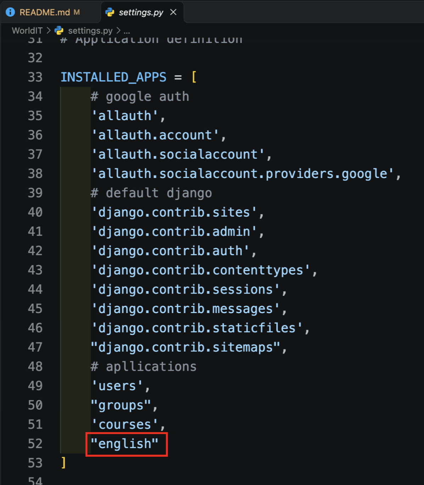

4. Указать ID записи курса английского. ID берется из БД, и указывается в константе ENGLISH_COURSE_ID в WorldIT/settings.py. Пример:

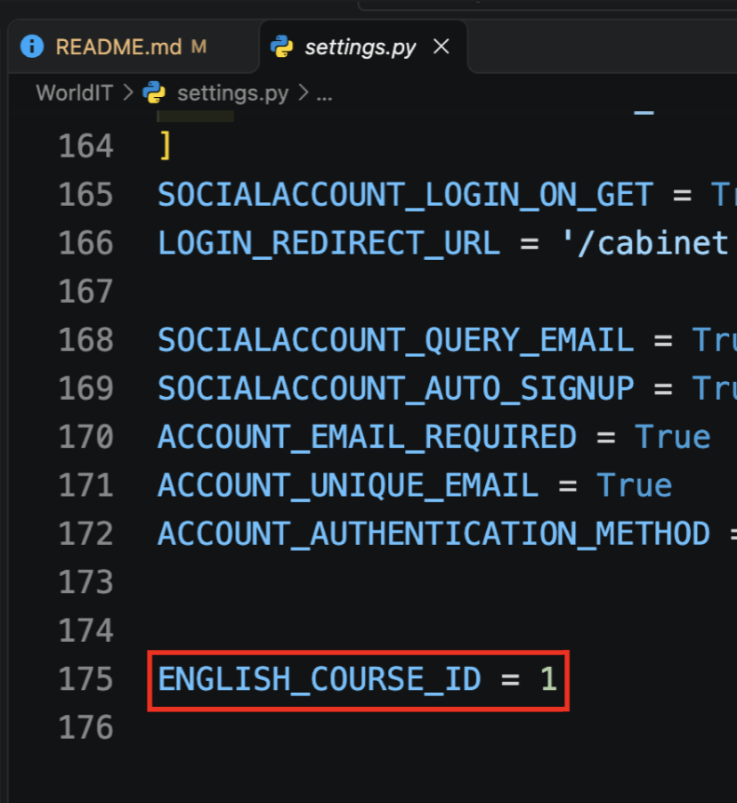

Обратите внимание на правильность написания названия константы, ведь её использует приложение english

5. Добавить условие в WorldIT/templatetags/menu_tags.py:

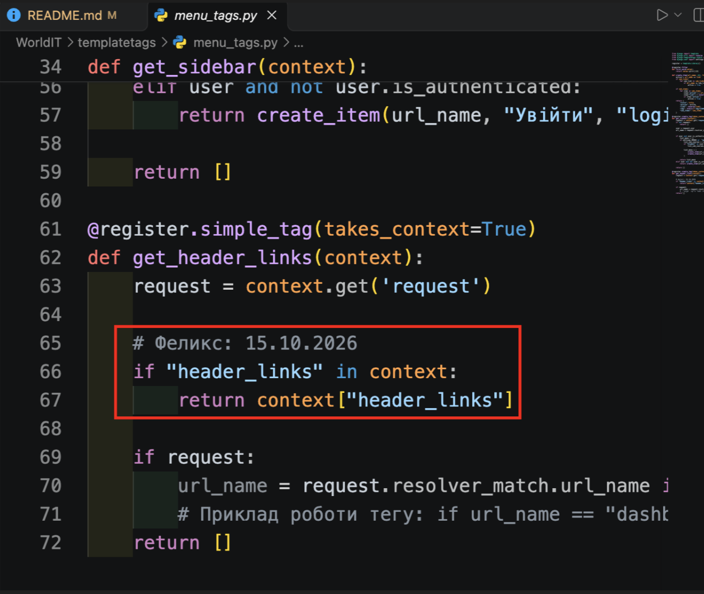

Данное условие необходимо для поддержания динамических ссылок, в шапке:
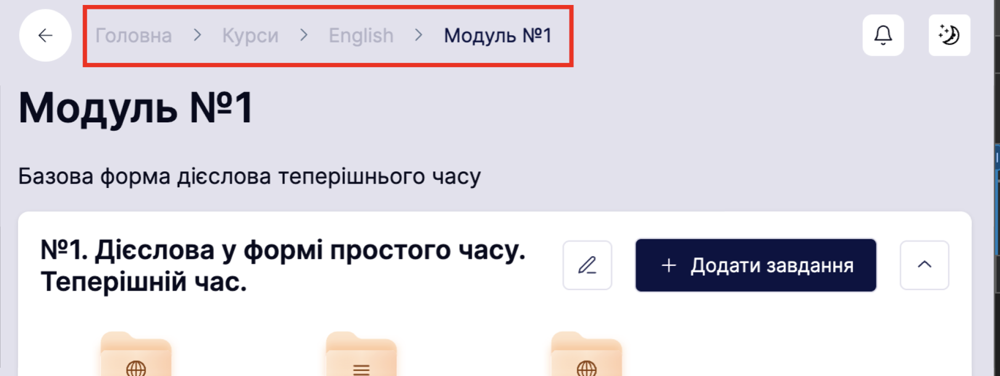

Без этого условия не вышло бы настроить переход по страницам отдельных заданий или же отдельных модулей
Мне неизвестно, находится ли подобное условие в основной платформе. Исходя из этого, я написал его сам

6. Обновить шаблон templates/base_cabinet.html
Заменить имеющуюся версию тега `<a>`, на обновленную:
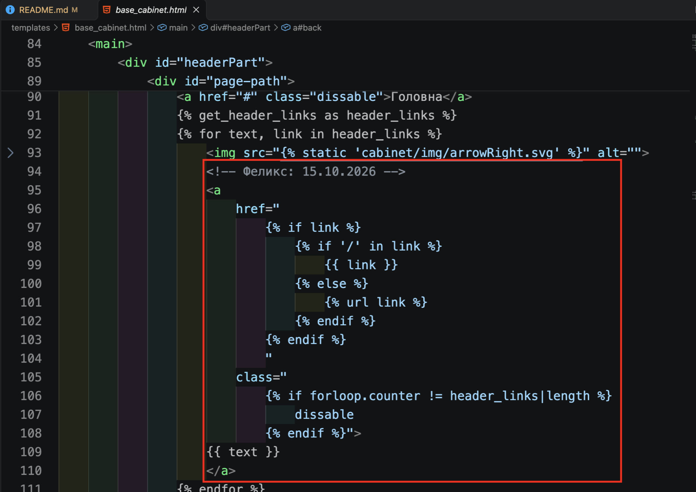

Необходимо для корректной настройки ссылок в шаблоне
В пункте 5. была настроена маршрутизация
Здесь настроено само отображение ссылок

```html
<!-- Феликс: 15.10.2026 -->
<a 
    href="
        
            
                {{ link }}
            
                
            
        
        " 
    class="
         
            dissable
        ">
{{ text }}
</a>
```

7. Обновить WorldIT/urls.py:

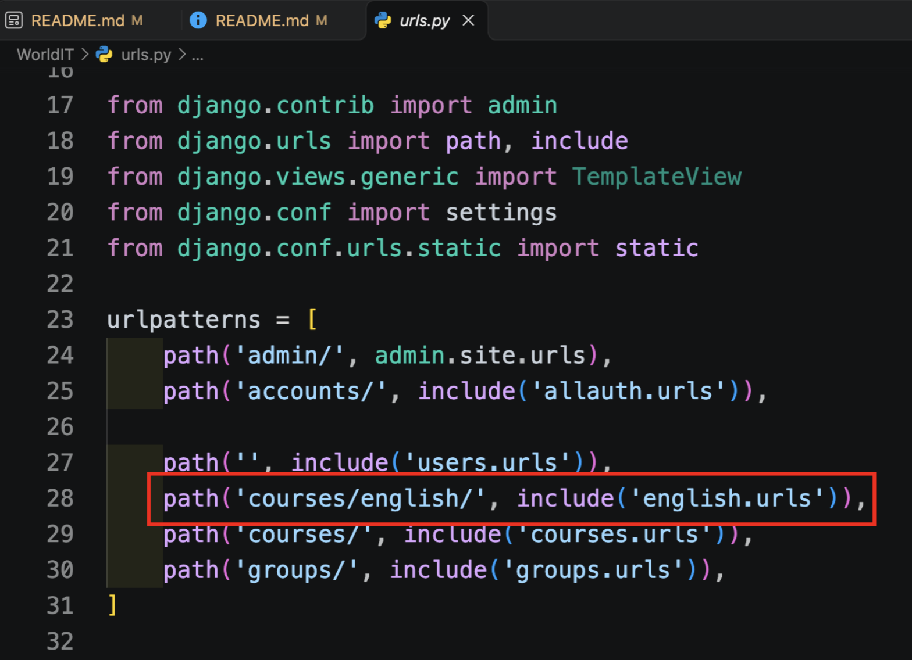


8. В корне проекта выполнить команду:
```bash
python manage.py check
```

Будут получены такие предупреждения:
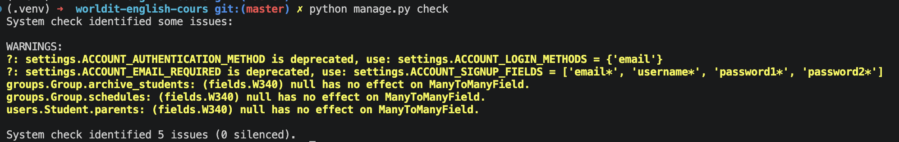

С приложением english они никоим образом не связаны

Если нету ошибок или предупреждений, связанных с приложением english или с ядром приложения (WorldIT), то можно спокойно переходить к пункту 8

9. Выполнить команду:
```bash
python manage.py showmigrations english
```

Если команда даёт такой результат:
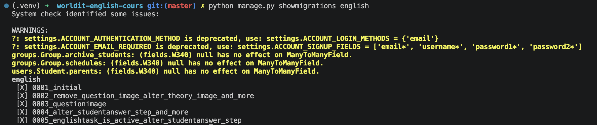

То есть отображает миграции до 0005 включительно
То можно можно переходить к пункту 9

10. Выполнить команду:
```bash
python manage.py migrate english
```

Если при выполнении миграций не произошло ошибок,  запускаем:
```bash
python manage.py runserver
```


Далее можно перейти по маршруту /admin и увидеть блок приложения english:
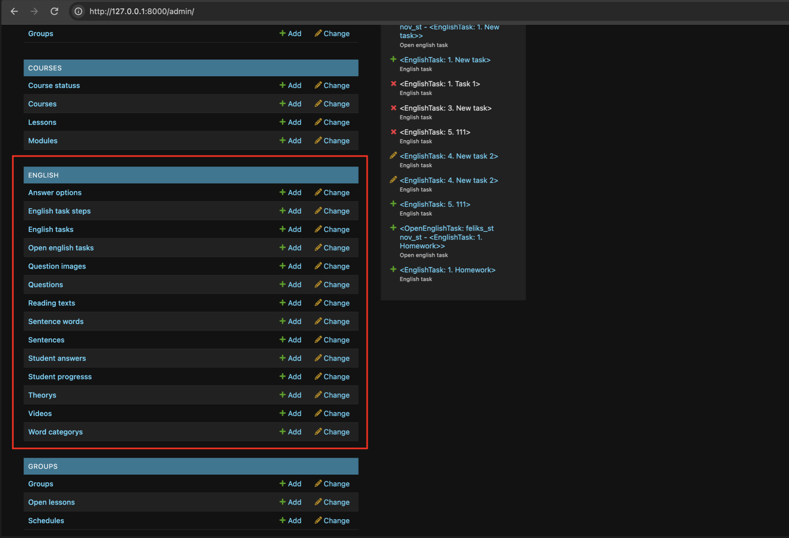

Если блок отображается в админке, то приложение подключено успешно

#### Создание задания
Для создания задания, необходимо подготовить: модуль, урок в нём

Модуль создаём на странице админки Module

Урок на странице Lesson

При создании урока, **в моей версии платформы** возникала ошибка:
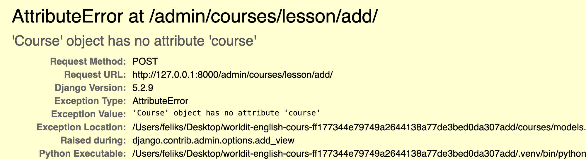

Ошибка связана с тем, что Lesson был связан не с Module, а с Course:
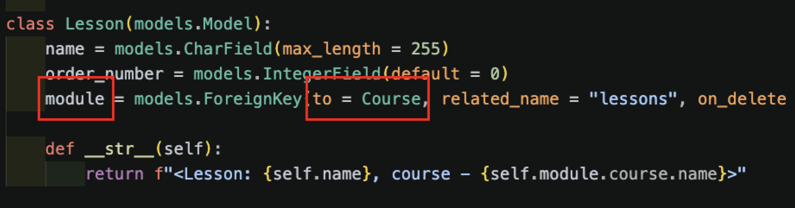

Рискну предположить, что в основной платформе эта ошибка была исправлена. Но стоило бы это перепроверить

---

Для непосредственного создания задания переходим на страницу English Task

На странице указываем: 
 - название задания, 
 - его блок (блок в уроке), 
 - тип (слова, предложения и пр.), 
 - иконку, 
 - порядок (порядок уникальный для блока урока. То есть: в блоке "Основний урок" может быть только одно задание с order=1, как пример),
 - доступно ли задание (поле is_available), 
 - не в архиве ли оно (is_active), 
 - урок, который на этот момент уже должен быть создан

Так как на момент подключения приложения english, реализован только тип заданий "Слова", то и в типе задания выбираем "Слова"

Пример заполненного задания:

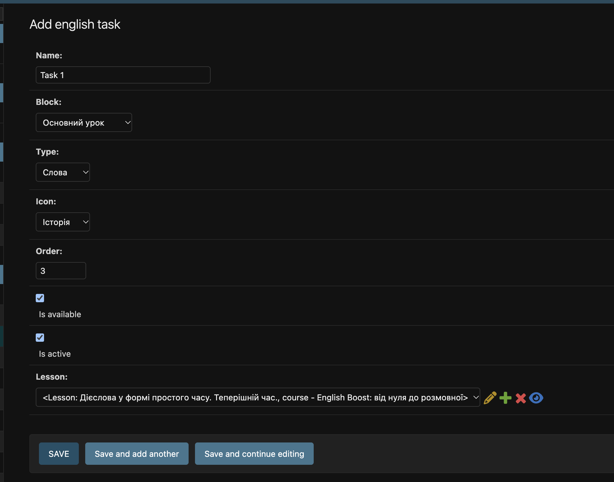

Далее можно перейти по маршруту: courses/english/ и перейти на страницу конкретного модуля:

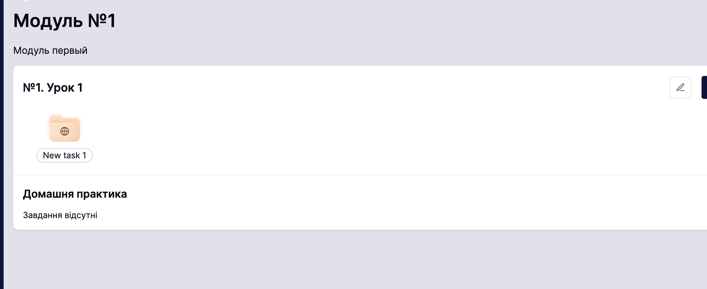

#### Загрузка csv
Переходим на страницу задания, и через имеющийся интерфейс загружаем csv со словами:
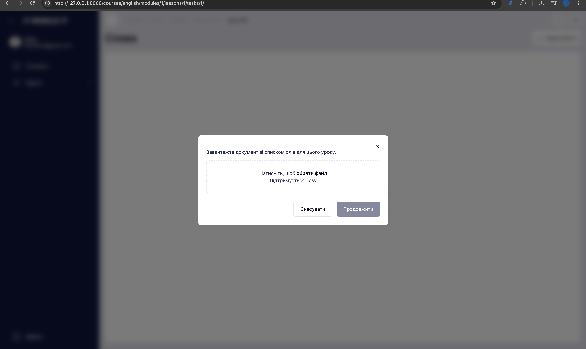

#### Выдача доступа студенту
Для тестировки прохождения со стороны студента, создаём запись OpenEnglishTask, в которой указываем студента задание, которое намерены ему открыть:
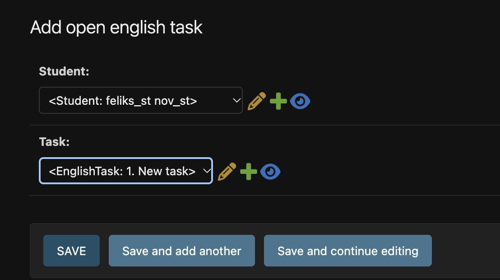
